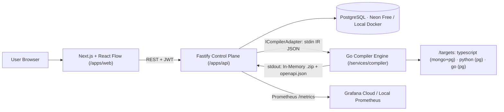

# Visual Backend Generator — Software Requirements Specification (v3.1 — Implementation-Ready)

> **Working Title:** Visual-to-Polyglot Backend Generator (`APP_NAME` configurable in `apps/web/src/config/brand.ts`, default `"BackendGen"`)
> **Core Flow:** Drag-and-drop infinite canvas (or Dual Relational/MongoDB Schema Import) → Validated IR → Deterministic, Runnable Backends: TypeScript (Express 5 + MongoDB AND Postgres), Python (FastAPI + Postgres), Go (chi + pgx + Postgres); Rust as stretch.
> **Owner:** Solo developer · **Initial timebox:** ~89 focused hours for a prototype attempt, not a guaranteed estimate for the entire scope. Re-estimate after the first end-to-end vertical slice.
> **Audience:** Developers, low-code builders, and technical evaluators/interviewers.

---

## 1. Introduction

### 1.1 Purpose
This document specifies the complete functional requirements, non-functional requirements, hexagonal monorepo architecture, visual design system, Git branching workflow, and task-by-task delivery plan for a web platform where a user drags and drops data-model blocks (entities, fields, relations, endpoints, auth) onto an infinite canvas—or imports an existing Relational/MongoDB schema—and receives a working, tested backend project in their chosen language.

### 1.2 Goals
1. **Working Product:** Drag-and-drop canvas (plus schema import) → validated IR → generated backend, running locally or in CI with one command.
2. **Scalable Plugin Structure:** Adding a new language means adding a folder under `/targets`, without changing the compiler core or platform API.
3. **Low-Resource & Low-Cost Deployment:** Keep the normal development workflow lightweight on an 8 GB laptop. Measure actual memory use and document it; free-tier deployment is a best-effort option, not a guarantee of permanent $0 hosting.
4. **High Resume & Engineering Value:** Demonstrates compiler design (IR), ports-and-adapters architecture, deterministic code generation, CI acceptance matrices, containerization, and observability. Terraform and advanced concurrency are secondary to a reliable end-to-end product.

### 1.3 Scope
* **In Scope (v1 — staged delivery; P0 means required for a usable MVP, not necessarily all in the first milestone):**
  * Infinite drag-and-drop canvas (pan, zoom, minimap, keyboard shortcuts, undo/redo).
  * Entity, field, and relation (`1:1`, `1:N`, `N:M`) modeling + auto-CRUD endpoint toggles + JWT auth block.
  * **Dual Schema Importer (Pivot C):** Import Relational (`schema.prisma` / PostgreSQL `CREATE TABLE` DDL) OR Document (`Mongoose` schema / MongoDB JSON) directly in the browser into the IR with `@dagrejs/dagre` automatic node layout (parser-only, AST-only for Mongoose, never `eval`).
  * **Project Database Option:** `postgres` or `mongodb`.
  * **Simple and Advanced Display Modes** editing the same underlying IR.
  * **Unified Theme System:** Stitch Industrial Light Mode + Obsidian Studio Dark Mode sharing identical sharp geometry (`2px` radius, `3px 3px 0px` offset shadow) and **Obsidian glowing Bezier relation edges** across both themes (glow and animation on hovered or selected edges).
  * **Code Generation Targets (full v1 target matrix; implement incrementally):**
    1. `typescript` (Express 5 + **Mongoose/MongoDB**)
    2. `typescript` (Express 5 + **Drizzle/PostgreSQL** + SQL migrations)
    3. `python` (FastAPI + **SQLAlchemy/PostgreSQL** + Alembic migrations)
    4. `go` (chi + **pgx/PostgreSQL** + SQL migrations)
  * **Instant Interactive API Preview:** Embedded OpenAPI 3.1 Mock Playground (`@scalar/api-reference`) + Code File Tree viewer in a slide-over drawer.
  * Deterministic `.zip` download, local `docker compose up`, GitHub Actions CI acceptance suite, one supported deployment path, and basic health/logging. Grafana Cloud and Terraform are later hardening tasks.
* **Out of Scope (Post-v1 Roadmap):** Real-time multiplayer (Yjs), AST 3-way code merging, zero-downtime migrations (`pgroll`), Firecracker microVMs, Rust (`axum` + `sqlx`), MongoDB targets for Python/Go, hosting generated user apps long-term, and per-route role policies beyond the basic role-aware auth contract.

### 1.4 Definitions
| Term | Meaning |
|---|---|
| **IR** | Intermediate Representation: a versioned, language-agnostic JSON model of the backend |
| **Target** | A language/framework plugin under `/targets` (e.g., `typescript`, `python`, `go`) |
| **Reference App** | A hand-written ideal backend for one target/DB pair, used to extract templates |
| **Acceptance Suite** | A shared HTTP CRUD + Auth test runner executed against every generated backend in CI |
| **Control Plane** | The Node.js/Fastify API managing auth, projects, IR versions, and build orchestration |
| **Compute Plane** | The stateless Go compiler engine transforming `IR JSON` → formatted project `.zip` + `openapi.json` |

---

## 2. Overall Description

### 2.1 User Personas
* **Developer (Primary):** Wants to scaffold a production backend visually (or migrate an existing schema to Go/Python/TS) and own clean code. Uses **Advanced Mode** (exact types, `PK`/`FK`/`UQ` badges, index indicators, relation notation).
* **Low-Code Builder (Primary):** Draws an app using drag-and-drop blocks or plain templates. Uses **Simple Mode** (friendly labels like `Text`, `Number`, `Yes/No`, `has many`) and the instant OpenAPI preview.
* **Evaluator / Interviewer (Secondary):** Reviews the GitHub repo, `DECISIONS.md`, `FLOW.md`, CI acceptance suite, and live deployed URL.

### 2.2 Hardware & Operational Constraints
* Solo developer working on an **8 GB RAM Windows/WSL2 laptop** (AMD Ryzen 5 5600H, GTX 1650).
* Daily development should avoid heavy background containers. The actual RAM footprint is measured and reported in the README; `< 550 MB` is not a hard requirement unless measurements show it is achievable for the defined process boundary.
* Daily development does not require Docker or WSL. Docker Desktop (WSL 2 on Windows) is optional and only needed to run generated-app acceptance tests or `docker compose up` locally; GitHub Actions runs the full acceptance matrix.
* Full stack must still support `docker compose up` for self-hosters and CI verification.

### 2.3 Assumptions & Code Ownership Contract
* Generated code and user-written custom code live in strictly separated directories. Every generated target MUST use the same root-level convention: `generated/` for compiler-owned files and `custom/` for developer-owned hooks/extensions. Regeneration may replace `generated/` only; it MUST preserve `custom/`. Generated code calls custom hooks through documented interfaces and must remain runnable when no custom hook is implemented.

---

## 3. Functional Requirements

### 3.1 Drag-and-Drop Canvas & Schema Importer (`apps/web`)
| ID | Requirement | Priority |
|---|---|---|
| **FR-01** | **Drag-and-Drop Creation:** Drag Entity, Relation, and Auth blocks from the left rail or bottom dock (`[+ ADD BLOCK]`) onto an infinite React Flow canvas | P0 |
| **FR-02** | Add, edit, reorder, and remove fields (`name`, `type`, `required`, `unique`, `default`, `enumValues`) in the Right Inspector Panel | P0 |
| **FR-03** | Draw relations between entity handles (`1:1`, `1:N`, `N:M`) using **Obsidian-style Bezier edges** with centered relation label pills (glow and animation on hovered or selected edges, see 6.2) | P0 |
| **FR-04** | Toggle generated REST CRUD operations (`list`, `get`, `create`, `update`, `delete`) per entity in the Inspector `API` tab | P0 |
| **FR-05** | Display real-time IR validation errors as warning/error badges directly on invalid nodes and edges | P0 |
| **FR-06** | Undo/redo history (`Zundo`) and keyboard shortcuts (`Delete`/`Backspace`, `Ctrl/Cmd+Z`, `Ctrl/Cmd+Y`, `Ctrl/Cmd+S`) | P0 |
| **FR-07** | **Auth block:** Enable JWT authentication and configure the allowed roles list. Generate register/login endpoints and authentication middleware. In v1, roles are validated and included in the user/token contract, but authorization is authentication-only unless an endpoint explicitly declares a role policy. Per-route role guards are P1. | P0 (JWT auth); P1 (role-based authorization) |
| **FR-08** | Custom Hook slots (generates typed stub files in `custom/hooks/` called by generated controllers) | P2 |
| **FR-09** | **Dual Schema Importer (Relational + MongoDB), browser-side:** Importer supports a documented subset of Prisma schema, PostgreSQL `CREATE TABLE` DDL, Mongoose `new Schema({...})` object-literal definitions, and sample MongoDB JSON documents. Mongoose parsing uses `@babel/parser` AST traversal only—never `eval` or `new Function`. JSON inference uses the supplied document(s) as samples and labels inferred/ambiguous types for user review; it does not claim to recover a complete MongoDB schema from one document. Parsing runs in a Web Worker with a 1 MB input limit, produces validated IR plus structured warnings/errors, and auto-layouts nodes with `@dagrejs/dagre`. Unsupported syntax must fail with an actionable diagnostic rather than being silently ignored. | P1 after core vertical slice |

### 3.2 IR Contract & Validator (`packages/ir-schema`)
| ID | Requirement | Priority |
|---|---|---|
| **FR-10** | IR is a strictly versioned JSON document (`irVersion: "1.0"`) with immutable UUID/nanoid IDs (`ent_*`, `fld_*`, `rel_*`) on every object | P0 |
| **FR-11** | Portable type set: `string`, `int`, `decimal`, `bool`, `timestamp`, `uuid`, `json`, `enum` | P0 |
| **FR-12** | **Validator (`Ajv` + semantic and security rules):** Rejects duplicate identifiers/names, unsupported reserved identifiers, dangling relations, invalid relation cardinality, invalid foreign-key definitions, unsupported target/type combinations, and missing/invalid primary keys. Names used as identifiers must match `^[A-Za-z_][A-Za-z0-9_]{0,63}$`; enum values must match `^[A-Za-z0-9_-]{1,64}$`. Defaults are typed literals or the explicit enum `uuid()` / `now()` forms; arbitrary expressions are forbidden. Limits: 50 entities, 100 fields/entity, 1 MB imported schema, and bounded compile request size/time. ZIP paths are compiler-owned constants plus validated identifiers, never raw user paths. Reserved-word policy is target-aware: quote/escape only where deliberately supported; otherwise return a validation error. | P0 |
| **FR-13** | **Semantic content hashing:** Explicit saves and Generate create an immutable `ir_versions` record whose SHA-256 hash is computed over canonical JSON containing only `irVersion`, `project`, `entities`, `relations`, `endpoints`, and `auth`. Canonicalization recursively sorts object keys, preserves array order where order is semantically meaningful, and excludes `layout`. If the hash equals the latest version hash, no duplicate version is created. Hash algorithm/canonicalization are named in code and covered by fixtures. | P0 |
| **FR-14** | **Decoupled layout:** Canvas metadata (`x`, `y`, `color` per entity) is stored in `layout.nodes[entityId]`, separate from semantic entity definitions, and persisted as mutable project state. Moving a node never creates a semantic IR version or changes compiler output. The full saved project document may contain `layout`; the compiler receives only the semantic IR projection. | P0 |

### 3.3 Polyglot Code Generation (`services/compiler` + `/targets`)
| ID | Requirement | Priority |
|---|---|---|
| **FR-20** | Generate complete runnable project for `typescript` + `mongodb` (Express 5 + Mongoose + Zod + JWT) | P0 |
| **FR-21** | Generate complete runnable project for `typescript` + `postgres` (Express 5 + Drizzle ORM + SQL migrations + Zod + JWT) | P0 |
| **FR-22** | Generate complete runnable project for `python` + `postgres` (FastAPI + SQLAlchemy 2.0 + Pydantic v2 + Alembic migrations + JWT) | P0 |
| **FR-23** | Generate complete runnable project for `go` + `postgres` (chi router + `pgx/v5` + SQL migrations + JWT) | P0 |
| **FR-24** | Every generated `.zip` includes a consistent `generated/` vs `custom/` split, CRUD routes/controllers, DB models and migrations where applicable, `openapi.json` (OpenAPI 3.1), `Dockerfile`, `docker-compose.yml` (app + selected DB), `.env.example`, and `README.md`. Generated files are replaceable; custom files are preserved by the documented regeneration workflow. | P0 |
| **FR-25** | **Determinism:** Same canonical semantic IR + same compiler version + same target manifest/template set = byte-for-byte identical ZIP output. File paths are sorted, generated content has stable ordering, ZIP timestamps and permissions are fixed, and no timestamps/random IDs are introduced during generation. Any IDs needed in generated code must derive from IR or stable compiler rules. | P0 |
| **FR-26** | **Plugin Architecture:** Each target resides in `/targets/<target>/` with `manifest.yaml`, `templates/`, `reference-app/`, and `tests/` | P0 |
| **FR-27** | Generated code is cleanly formatted (`gofmt` native in Go; clean template indentation for TS/Python). The acceptance suite also runs `tsc --noEmit`, `ruff check`, `python -m compileall` and `go vet` on every generated project | P0 |
| **FR-29** | The databases each target supports are declared in `targets/<target>/manifest.yaml` (`databases:` list) and enforced by the validator. v1: `typescript: [postgres, mongodb]`, `python: [postgres]`, `go: [postgres]`. `project.database` is `"postgres"` or `"mongodb"`; `_id` is reserved in MongoDB and mapped to `ObjectId` | P0 |

### 3.4 Build Pipeline & Instant API Preview
| ID | Requirement | Priority |
|---|---|---|
| **FR-30** | **Hexagonal `ICompilerAdapter` in `apps/api`:** `local-binary` mode invokes the compiler through stdin/stdout with a configurable binary path and a hard timeout. The adapter contract supports preview and download operations. `cloud-queue` is deferred and must not be presented as a working mode in v1. Startup readiness fails clearly if the configured compiler binary is missing. | P0 (local-binary) / Out of scope for v1 (cloud queue) |
| **FR-31** | Go Compiler renders templates into an in-memory file map and creates ZIP output without temporary project files. Sequential rendering is acceptable initially; concurrency may be added only if profiling shows a benefit. Output ordering must be deterministic regardless of execution strategy. | P0 |
| **FR-32** | Build status (`queued`, `running`, `success`, `failed`), execution time (`duration_ms`), logs, and downloadable `.zip` stream exposed via REST API | P0 |
| **FR-34** | **API Preview & Code Viewer:** Slide-over drawer with an OpenAPI 3.1 viewer and a generated file tree. Interactive request execution is enabled only when a real preview/mock server is available; an OpenAPI viewer alone is not described as a mock server. For the MVP, a static OpenAPI viewer and file tree are sufficient; IR-derived mock handlers are a later enhancement. | P1 |

### 3.5 Platform Backend (`apps/api`)
| ID | Requirement | Priority |
|---|---|---|
| **FR-40** | Platform signup/login uses password hashing (`argon2id` preferred; bcrypt is an explicitly configured fallback) and short-lived bearer JWTs. The browser stores the access token in memory, not localStorage; refresh/persistent sessions are out of scope for the MVP. Next.js `/api/*` rewrites proxy API requests but are not described as cookie protection. Guest projects are stored in localStorage; guest editing and generation work without an account, while cloud saving requires login. Generated-backend authentication is a separate contract. | P0 |
| **FR-41** | Projects CRUD (`GET/POST/DELETE /projects`), append-only IR Version History (`GET/PUT /projects/:id/ir`, `GET /projects/:id/versions`) and lightweight layout autosave (`PATCH /projects/:id/layout`) | P0 |
| **FR-42** | Rate limiting (`@fastify/rate-limit`) and request size limits on auth, guest compile and build generation endpoints | P0 |

### 3.6 Experience, Themes & UI (`apps/web`)
| ID | Requirement | Priority |
|---|---|---|
| **FR-50** | **Simple / Advanced Mode Toggle:** Topbar segmented control persisted per user; both modes read/write the exact same IR | P0 |
| **FR-51** | **Simple Mode:** Shows friendly labels (`Text`, `Number`, `Yes/No`, `Date & Time`, `Choice List`, `Link to Table`), hides `PK`/`FK`/`UUID` technical rows, and displays `HAS MANY` / `BELONGS TO` on edge chips. **Advanced Mode:** Shows full schema types (`String(255)`, `UUID`, `Boolean`), `PK`/`UQ`/`FK` badges, and `1:N` / `N:M` notation | P0 |
| **FR-52** | **Unified Dual Theme System:** Ships with **Light Theme** (*Stitch Industrial Concrete*) and **Dark Theme** (*Obsidian Studio*). Both share identical geometry (`--radius: 2px`, `--border-w: 1.5px`, `3px 3px 0px` hard offset shadows, `#B5F425` Acid Lime primary accent) so switching themes never shifts layout | P0 |
| **FR-55** | 6-color entity header palette (`Lime #B5F425`, `Coral #FF6B8B`, `Teal #14B8A6`, `Amber #FBBF24`, `Violet #A78BFA`, `Sky #38BDF8`) stored in `layout.nodes[id].color` | P0 |
| **FR-56** | **Obsidian Glowing Bezier Edges (Both Themes):** Smooth curved SVG edges (`getBezierPath`) colored by source entity palette, dashed stroke for `N:M`, solid stroke with arrow marker for `1:1`/`1:N`, and a centered pill badge. The SVG glow and animated dashes activate only on hovered or selected edges and respect `prefers-reduced-motion` | P0 |
| **FR-58** | Welcome / Project Launch Screen (Stitch Screen 1): Mode selector (`Simple` vs `Advanced`), Dual Schema Import tabs (`Relational Prisma/SQL` vs `MongoDB Mongoose/JSON`), and 3 one-click starter templates (`Blog & Publications`, `Online Store`, `Task & Project Tracker`) | P0 |

---

## 4. Non-Functional Requirements

| Area | Requirement |
|---|---|
| **Performance** | Establish a repeatable benchmark using a checked-in 20-entity fixture. Record compiler-only latency and API end-to-end latency separately on documented hardware; report median and p95 after warm-up. Initial targets are compiler-only p95 < 500 ms and warm local preview p95 < 1.5 s. These are goals to validate, not assumptions. Cold-start latency is reported separately. |
| **Local Resource Footprint** | Avoid requiring local database/container services for ordinary UI/API development by using a configured remote dev database or mocks. Measure web, API, compiler, and supporting processes separately on the target 8 GB Windows/WSL2 laptop. Report idle and active peaks; do not claim a hard <550 MB total until measurements prove it. Docker acceptance tests are optional locally and required in CI. |
| **Reliability & Determinism** | Compiler is stateless. Identical canonical semantic IR, compiler version, target manifest, and templates produce byte-identical ZIP output. |
| **Security** | Strict schema validation and typed/allowlisted defaults; AST-only importer; request/input limits and compiler timeout; platform passwords hashed with Argon2id (bcrypt fallback only if explicitly configured); JWT secrets supplied through environment configuration; ownership checks on all project APIs; generated app secrets never hardcoded; containers run as non-root; dependency and container scans in CI. Rate limits and error responses must not leak secrets. |
| **Extensibility** | Adding a target that supports the existing IR contract should require no changes to `apps/api`; IR changes are allowed only when the new capability is genuinely part of the language-agnostic model. Target manifest and conformance tests define the plugin contract. Rust is not a v1 target. |
| **Observability** | Structured logs, `/healthz` and `/readyz`, and request/build duration metrics. `/metrics` and Grafana Cloud integration are P1; the MVP must at least expose health checks and useful sanitized build errors. |
| **Portability** | `docker compose up` boots the entire self-hosted stack locally or on any Linux VM |

---

## 5. System Architecture & Data Contracts

### 5.1 Hexagonal Multi-Stage Architecture


### 5.2 Monorepo Directory Structure
```text
/apps
  /web                      Next.js + React Flow + Dual Schema Importer (Web Worker) + Scalar OpenAPI Drawer
  /api                      Node/Fastify Control Plane (Auth, Projects, IR Versions, CompilerAdapter)
/services
  /compiler                 Go Engine (CLI + HTTP server modes, goroutine templates, archive/zip; version pinned in go.mod)
/targets                    Decoupled Language Plugins
  /typescript               manifest.yaml · reference-app/ · tests/
    /storage/mongodb        Express 5 + Mongoose templates
    /storage/postgres       Express 5 + Drizzle ORM + SQL migration templates
  /python                   manifest.yaml · FastAPI + SQLAlchemy + Alembic templates · reference-app/
  /go                       manifest.yaml · chi + pgx + SQL migration templates · reference-app/
/packages
  /ir-schema                JSON Schema + Ajv Validator + Relational/Mongo Importers + Example IRs
/infra
  /Dockerfile               Multi-Stage (Stage 1: Go builds compiler -> Stage 2: Node LTS runs API + Go binary; versions pinned)
  /docker-compose.yml       Full local self-hosted stack (web, api+compiler, postgres)
  /terraform                Cloud infrastructure as code
/design                     Exported Stitch HTML/CSS & reference screenshots
/docs
  SRS.md                    This master specification
  PROGRESS.md               Updated after EVERY task (Current state, last completed task, next step)
  DECISIONS.md              Log of every architectural, library, and schema decision made by AI/Dev
  FLOW.md                   End-to-end documentation of data & code execution flows across the monorepo
  /tasks                    Individual task specs (T01.md .. T15.md)
AGENTS.md                   Strict AI rules, Git workflow (`working` -> `staging`), and memory protocol
```

### 5.3 IR v1.0 JSON Contract (`packages/ir-schema`)
The IR is semantic. Cosmetic data (positions, colours) lives in `layout`, which is excluded from hashing and compilation. The snippet below is illustrative, not a valid test fixture: it omits the `ent_post` entity and its `authorId` field for brevity. Executable fixtures must be complete and valid.
```json
{
  "irVersion": "1.0",
  "project": {
    "name": "production-api-v1",
    "database": "postgres"
  },
  "entities": [
    {
      "id": "ent_user",
      "name": "User",
      "tableName": "users",
      "fields": [
        { "id": "fld_1", "name": "id", "type": "uuid", "required": true, "unique": true, "isPrimaryKey": true, "default": "uuid()" },
        { "id": "fld_2", "name": "email", "type": "string", "required": true, "unique": true },
        { "id": "fld_3", "name": "role", "type": "enum", "required": true, "enumValues": ["ADMIN", "USER"], "default": "USER" },
        { "id": "fld_4", "name": "createdAt", "type": "timestamp", "required": true, "default": "now()" }
      ]
    }
  ],
  "relations": [
    {
      "id": "rel_user_posts",
      "fromEntityId": "ent_user",
      "toEntityId": "ent_post",
      "kind": "one-to-many",
      "foreignKeyField": "authorId",
      "onDelete": "CASCADE"
    }
  ],
  "endpoints": [
    { "entityId": "ent_user", "ops": ["list", "get", "create", "update", "delete"], "authRequired": true }
  ],
  "auth": { "enabled": true, "strategy": "jwt", "roles": ["ADMIN", "USER"] },
  "layout": {
    "nodes": { "ent_user": { "x": 120, "y": 140, "color": "lime" } }
  }
}
```

### 5.4 Normative IR Semantics (Required Before Target Implementation)

The IR is the stable, language-agnostic source of truth. All targets must implement the same meaning for each supported field and relation. Target-specific details belong in target manifests and generated code, not in ad-hoc frontend logic.

**Canonical semantic document**
- Required top-level keys: `irVersion`, `project`, `entities`, `relations`, `endpoints`, and `auth`.
- `layout` is project/UI state and MUST be removed before validation for compilation, hashing, or target generation.
- IDs are immutable and unique within the document. Human-readable names are not identifiers.
- Unknown keys are rejected in v1 to avoid silent data loss.
- Canonical hash input uses recursively sorted object keys and stable array order. Entity, field, relation, and endpoint arrays are sorted by immutable ID for hashing only, unless an explicitly documented ordering field is added later. The compiler must not reorder user-visible fields in the stored IR.

**Field semantics**
- `required: true` means the value must be present on create and cannot be null. For update requests, omitted fields remain unchanged; explicit null is rejected for required fields.
- `unique: true` means the target database must enforce uniqueness. The acceptance suite checks duplicate writes.
- `default` is optional and must be type-compatible. Supported defaults in v1 are typed literal values, `uuid()`, and `now()` only for compatible field types. Arbitrary source expressions are forbidden.
- `enumValues` is required only for `enum` fields, must be non-empty and unique, and each value must match the allowed enum pattern.
- Primary keys are explicit in the IR. Exactly one primary key is required per entity in v1. For PostgreSQL targets, the default supported primary key is UUID; for MongoDB, the compiler maps the logical primary key to `_id`/ObjectId unless an explicit compatible strategy is later introduced.
- `decimal` must preserve decimal semantics in PostgreSQL/Python/Go targets; targets must not silently map it to floating-point storage where precision would be lost.

**Relationship semantics**
- `fromEntityId` is the principal/source entity and `toEntityId` is the related/target entity. `kind` is `one-to-one`, `one-to-many`, or `many-to-many`.
- `foreignKeyField` is required for `one-to-one` and `one-to-many` and names a field on the entity that stores the reference. For `one-to-many`, the foreign key is on the `toEntityId` (many-side) entity. For `one-to-one`, the v1 convention is a foreign key on the `toEntityId` entity with a uniqueness constraint. For `many-to-many`, `foreignKeyField` is omitted; the target generates a deterministic join table/collection representation.
- The foreign-key field must exist on the correct entity, have a compatible type, and reference the principal entity's primary key. The v1 model does not support composite keys.
- `onDelete` is one of `RESTRICT`, `CASCADE`, or `SET_NULL`. `SET_NULL` requires the foreign-key field to be nullable. If a database/target cannot implement a requested action faithfully, compilation fails with a diagnostic; it must not silently change behavior.
- Self-relations are allowed only when explicitly modeled and valid under the same rules. Cycles between entities are not rejected merely because they exist; only invalid nullability/constraint combinations are rejected.

**Target capability contract**
- Each target manifest declares supported database(s), IR version(s), field types, relation kinds, delete actions, auth capabilities, and required toolchain/runtime versions.
- A target must reject unsupported semantics before emitting a ZIP. No target may silently omit a field, relation, constraint, or endpoint.
- The shared acceptance suite defines cross-target behavior for supported semantics. Target-specific deviations must be documented and tested.

**Example correction**
The illustrative IR in §5.3 is schematic; any executable fixture must define every referenced entity (including `ent_post`), every referenced foreign-key field, and all required keys. The checked-in fixtures used by tests are the normative examples.

### 5.5 Target Mapping: PostgreSQL vs. MongoDB

| Concept | PostgreSQL (`typescript`, `python`, `go`) | MongoDB (`typescript`) |
|---|---|---|
| **Primary Key** | `id` (`UUID`, `DEFAULT gen_random_uuid()`) | `_id` (`ObjectId`); virtual `id` getter exposed in JSON |
| **1:1 / 1:N Relation** | Foreign key column (`author_id UUID REFERENCES users(id)`) | `Schema.Types.ObjectId` with `ref: 'User'` |
| **N:M Relation** | Explicit SQL join table (`post_tags`) | Array of `ObjectId` references (`[{ type: ObjectId, ref: 'Tag' }]`) |
| **Schema Evolution** | Numbered `.sql` / Alembic migration files | Mongoose schema definitions + index creation script |

### 5.6 Platform Database Schema (`apps/api` — Drizzle + Postgres)
* `users(id, email, password_hash, created_at)`
* `projects(id, owner_id, name, database_type, layout_json, created_at, updated_at)` — `layout_json` is mutable (autosave)
* `ir_versions(id, project_id, version_number, ir_json, content_hash, created_at)` — immutable append-only, semantic IR only
* `builds(id, ir_version_id, target, database_type, status, duration_ms, error_log, created_at)`

### 5.7 Platform REST API Surface (`apps/api`)

All routes use the `/api` prefix except health/readiness endpoints. API errors use the common error envelope defined in §5.8. Project IDs are always ownership-checked; a caller cannot access another user's projects or versions.
| Method | Path | Purpose |
|---|---|---|
| `POST` | `/api/auth/signup`, `/api/auth/login` | User authentication |
| `GET/POST` | `/api/projects` | List or create projects |
| `GET/PUT` | `/api/projects/:id/ir` | Load latest IR or save new immutable IR version |
| `GET` | `/api/projects/:id/versions` | List version history for undo/rollback |
| `PATCH` | `/api/projects/:id/layout` | Autosave canvas layout (mutable, does not create a version) |
| `POST` | `/api/compile/preview` | Validate semantic IR and return JSON `{ openapi, files: [{ path, language? }], diagnostics, compilerVersion }`; no ZIP bytes in this response |
| `POST` | `/api/compile/download` | Validate and compile semantic IR, then stream only the deterministic ZIP (`application/zip`) directly to the browser; errors use a structured JSON response before streaming starts |
| `GET` | `/healthz`, `/readyz`, `/metrics` | Health checks and Prometheus metrics |

Schema importers run in the browser (Web Worker); there is no import endpoint. Compile endpoints also serve guests and are therefore rate-limited and size-limited (FR-42).

**Compiler process protocol (normative):**
- The API sends one UTF-8 JSON request on compiler `stdin`, terminated by EOF. The request includes `operation` (`preview` or `download`), `irVersion`, semantic IR, target, database, and compiler version constraints.
- The compiler writes protocol output to `stdout` only. Diagnostics and logs go to `stderr`; no log text may be mixed into protocol output.
- For `preview`, stdout is one JSON response containing the OpenAPI document, sorted file metadata, diagnostics, and compiler version. Generated source content is not required in the preview response.
- For `download`, stdout is the raw ZIP byte stream. The compiler must not append JSON after the ZIP. Process exit status is authoritative for failure; the adapter captures stderr and maps failures to a structured API error if response streaming has not started.
- The API validates request size and operation/target/database combinations before spawning the compiler. The compiler independently validates the IR and target support.
- The first implementation may invoke a separate process per request. The binary path is configured via environment and must not be hardcoded to `/usr/local/bin`.

---

### 5.8 Generated Backend Contract (Normative)

All v1 generated targets must implement the following shared behavior. Features not listed here are not implied to be supported.

**HTTP API behavior**
- JSON REST endpoints use a consistent `/api` prefix, except `/healthz` and `/readyz`.
- CRUD operations are generated only when enabled for the entity in `endpoints`.
- `list` supports bounded pagination (`limit` default 20, maximum 100) and deterministic ordering by primary key. Filtering/sorting are out of scope unless represented explicitly in the IR.
- `get` returns `404` when the record does not exist.
- `create` returns `201` on success and validates request data.
- `update` is partial-update/PATCH semantics: omitted fields remain unchanged; required fields cannot be set to null.
- `delete` returns `204` on success and `404` for a missing record.
- Validation errors return `400` with a stable error shape; unauthenticated requests return `401`; authenticated but unauthorized requests return `403`; uniqueness conflicts return `409`; unexpected errors return `500` without stack traces or secrets.
- Error shape: `{ "error": { "code": "VALIDATION_ERROR", "message": "Human-readable summary", "details": [] } }`. `details` may contain field-level diagnostics but no secrets.
- Generated apps include `/healthz`; `/readyz` checks database readiness.

**Authentication behavior**
- Generated `/auth/register` validates input and hashes passwords with a supported password-hashing library. Password hashes are never returned.
- Generated `/auth/login` returns a signed JWT containing a stable subject/user ID and only the minimum claims needed by the app. Signing secret is read from an environment variable and must fail startup if missing/unsafe.
- JWT expiry is configurable and has a documented default. Passwords and tokens are never logged.
- When auth is enabled, protected CRUD endpoints require a valid bearer token. Registration and login are public.
- V1 roles are an enum/list in the user/token contract only. They do not imply authorization policy unless a route policy is explicitly represented and supported. Per-route role guards are P1.
- Generated app secrets are never hardcoded. `.env.example` contains placeholders only.

**Migrations and runtime**
- PostgreSQL targets include ordered migrations and document how to apply them before serving requests. Docker Compose startup waits for database health and runs migrations through a documented command or entrypoint.
- MongoDB target documents index creation and startup connection behavior.
- Generated apps use environment variables for database URLs and secrets, run as a non-root user in containers, and include a README with install, migrate, run, test, and Docker instructions.
- Regeneration replaces compiler-owned `generated/` files only. `custom/` files are never overwritten; missing custom hooks resolve to safe no-op/default implementations.
- The acceptance suite tests CRUD, validation, missing records, duplicate uniqueness, authentication, malformed/expired JWTs, and database migration/startup behavior for every supported target.

### 5.9 Platform Authentication and Authorization Contract

- The platform API uses short-lived bearer access JWTs. The web client keeps the token in memory; reload requires signing in again in the MVP. No refresh token or persistent login is promised in v1.
- The Next.js rewrite is a same-origin routing convenience, not an authentication or CSRF security mechanism.
- Every project, IR version, layout, and build lookup is scoped to the authenticated owner. Guessing another project's ID must not reveal whether that project exists; respond with `404`.
- Guest projects remain entirely client-side in localStorage until the user explicitly signs in and imports/saves them. Guest compile endpoints receive the same strict validation, size limits, and rate limits as authenticated compile endpoints.
- Auth endpoints have rate limits. Passwords, JWTs, secrets, and full sensitive request bodies are excluded from logs.

## 6. UI, Unified Themes & Obsidian Edge Design Specification

### 6.1 Unified Light & Dark Geometry
Both themes share identical layout dimensions (`--radius: 2px`, `--border-w: 1.5px`, `3px 3px 0px` hard offset shadow, `#B5F425` Acid Lime primary buttons) based on the Stitch screens in `/design`:
* **Light Theme (`data-theme="light"` — Stitch Industrial Concrete):** Background `#F2F2EE`, Dot Grid `#C4C4BC`, Surface `#FFFFFF`, Secondary Surface `#F7F7F4`, Border `#141413`, Shadow `3px 3px 0px #141413`.
* **Dark Theme (`data-theme="dark"` — Obsidian Studio):** Background `#09090B`, Dot Grid `#27272A`, Surface `#121216`, Secondary Surface `#18181E`, Border `#3F3F46`, Shadow `3px 3px 0px #000000`, Selected Shadow `3px 3px 0px #B5F425`.

### 6.2 Obsidian Glowing Bezier Edges (Used in BOTH Light & Dark Modes)
Per design decision, relation edges on the React Flow canvas use the **Obsidian Custom Bezier Edge (`ObsidianRelationEdge.tsx`)** in **both** Light and Dark modes:
1. **Path Geometry:** Smooth Bezier curve (`getBezierPath` from `@xyflow/react`) connecting source field handle to target node handle.
2. **Dual-Layer SVG Glow (hovered or selected edges only):**
   * **Outer Glow Path:** `stroke={sourceEntityColor}`, `strokeWidth={6}`, `strokeOpacity={0.22}`, `filter="blur(3px)"`.
   * **Core Line Path:** `stroke={sourceEntityColor}` (or `#10B981` Emerald / `#141413` high-contrast core), `strokeWidth={2}`, dashed `strokeDasharray="6 4"` for `N:M` relations (animated only on hover or selection) and solid line with arrow marker for `1:1` / `1:N`.
3. **Interactive Edge Pill Badge (`EdgeLabelRenderer`):** Centered on the Bezier curve with a `1.5px` border, `2px` radius, and `2px 2px 0px` shadow displaying **`HAS MANY`** / **`MANY TO MANY`** in Simple Mode and **`1 : N`** / **`N : M`** in Advanced Mode.
4. **Performance Rule:** At rest, every edge renders only its core line. The outer glow path, the `blur` filter and the animated dashes activate only on hovered or selected edges and are disabled when `prefers-reduced-motion` is set. Test with 30 edges on the target laptop.

---

## 7. DevOps, Testing & $0 Deployment Strategy

### 7.1 Testing Matrix & Definition of Done
| Layer | Verification Method |
|---|---|
| **IR & Importers (`packages/ir-schema`)** | Vitest unit suite covering valid/invalid IRs, Postgres vs Mongo rules, and Relational/Mongo schema imports |
| **Go Compiler (`services/compiler`)** | `go test ./...` + Golden-file snapshot tests + Determinism check (compile twice, assert identical SHA-256) |
| **Generated Backends (CI Acceptance Matrix)** | GitHub Actions boots generated app + real Postgres/MongoDB service container and runs `tsc --noEmit`, `ruff check`, `python -m compileall`, `go vet` and shared CRUD + Auth HTTP smoke tests against all 4 P0 combinations: **1. TS+Mongo**, **2. TS+Postgres**, **3. Python+Postgres**, **4. Go+Postgres** |

### 7.2 Free Cloud Deployment Architecture ($0/Month)
1. **Frontend (`apps/web`):** Deployed to **Vercel Free Tier** (Root Directory: `apps/web`).
2. **Backend + Compiler (`infra/Dockerfile`):** Multi-Stage Docker image deployed to **Render / Koyeb Free Web Service** OR **AWS** (using free-tier credits, which expire; not free forever).
3. **Database:** **Neon.tech Serverless PostgreSQL** (free tier; no local database process; it suspends when idle).
4. **Monitoring:** `/metrics` scraped/pushed to **Grafana Cloud Free Tier**.
5. **Free-tier behaviour:** free instances may sleep when idle and take time to wake. Warm the app before a demo and check each provider's current free-tier terms.

---

## 8. Delivery Schedule & Task Backlog (Initial ~89-Hour Timebox; Re-estimate After Vertical Slice)

The hours below are planning hypotheses, not a delivery guarantee. The full scope may exceed this timebox substantially. A task is complete only when its exit criteria pass; do not mark a task complete because files were generated. **Milestone A (T1–T6) is the first coding objective.** Do not build the full visual editor or deploy all targets before one target passes the end-to-end acceptance suite.

| Task | Description | Hours | Exit Criteria & Verification Command |
|---|---|---|---|
| **T1** | Monorepo setup (`pnpm` + Go module), `AGENTS.md`, `PROGRESS.md`, `DECISIONS.md`, `FLOW.md`, Multi-stage `Dockerfile`, GitHub Actions CI skeleton | 4h | `pnpm build` & `go test ./...` pass on `working` branch, merged to `staging` |
| **T2** | `packages/ir-schema`: IR v1.0 JSON Schema, `Ajv` + semantic validator (Postgres & MongoDB rules), and 3 starter template IRs (`blog`, `shop`, `tracker`) | 5h | `pnpm --filter @backendgen/ir-schema test` passes 100% |
| **T3** | Defer schema importers until the compiler vertical slice works. Then implement one documented subset at a time: Prisma OR PostgreSQL DDL first, followed by Mongoose AST subset, then sample JSON inference. | 5h initial placeholder; re-estimate | Fixtures cover supported syntax, unsupported syntax, warnings, and invalid input |
| **T4** | **Go Compiler Core (`services/compiler`):** Parse and validate the defined compiler request protocol, load target manifest, render one target sequentially, generate OpenAPI and deterministic in-memory ZIP | 8h | `go test ./...` verifies protocol, errors, deterministic ZIP, OpenAPI generation, and benchmark fixture |
| **T5** | Hand-written reference app for the first chosen target + shared HTTP CRUD/auth acceptance runner | 6h | Reference app passes the shared suite; suite behavior becomes the target contract |
| **T6** | Generate the first target from IR, starting with TypeScript + MongoDB/Mongoose OR TypeScript + PostgreSQL/Drizzle (choose one and finish it before starting another) | 8h | Generated app builds, starts, migrates/initializes DB, and passes the same acceptance suite as the reference app |
| **T7** | Add the second TypeScript database target after T6 is green | 8h placeholder | Shared acceptance suite passes; unsupported semantics fail explicitly |
| **T8** | **UI Foundation & Welcome Screen (`apps/web`):** Build the welcome screen and starter IR templates; schema import tabs stay disabled/labelled coming later until importer tasks pass | 5h placeholder | Starter templates load valid IR and can proceed to the editor |
| **T9** | **Drag-and-Drop Canvas (`apps/web`):** Entity Nodes (Simple vs Advanced view), **Obsidian Glowing Bezier Edges**, Left Icon Rail, Bottom Floating Dock (`[+ ADD BLOCK]`, Undo/Redo, Zoom), Right Inspector (`FIELDS`, `API`, `RULES`) (Stitch Screens 2 & 3) | 14h | Full drag-and-drop creation, edge linking, field editing, and live validation badges work in Light & Dark mode |
| **T10** | **Preview Drawer:** OpenAPI viewer and generated file tree first; mock execution is deferred until a real mock/preview server is implemented | 4h placeholder | Preview matches compiler output and clearly distinguishes documentation from executable mocks |
| **T11** | **Control Plane API (`apps/api`):** Fastify + Drizzle/Postgres, ownership-checked projects/versioning, compiler adapter and ZIP download | 9h placeholder | Authenticated and guest flows compile; project ownership tests pass |
| **T12** | **Python Target (`/targets/python`):** FastAPI + SQLAlchemy 2.0 + Pydantic v2 + Alembic (Postgres) | 8h placeholder | Generated Python backend passes the shared acceptance suite |
| **T13** | **Go Target (`/targets/go`):** chi + pgx/v5 + SQL migrations (Postgres) | 8h placeholder | Generated Go backend passes the shared acceptance suite |
| **T14** | **Deployment and hardening:** Deploy web/API/database using one verified provider combination; health checks, secrets, rate limits and CI first. Grafana/Terraform are optional follow-up work. | 5h placeholder | Public HTTPS URL works, CI is green, secrets are configured safely, and documented free-tier caveats are accurate |
| **T15** | **Documentation & Demo Polish:** Finalize `README.md`, architecture diagrams, ADRs in `DECISIONS.md`, complete `FLOW.md`, and record 2–3 min demo video | 2h | All deliverables checked off |

---

### 8.1 Milestones and Scope Gate

- **Milestone A — Compiler vertical slice:** IR schema + semantic validation + one target manifest + compiler preview/download protocol + one generated backend + shared acceptance tests. No canvas polish, schema importer, cloud deployment, or second target is allowed to block this milestone.
- **Milestone B — Visual MVP:** starter IRs, canvas editing, live validation, compile preview/download, guest workflow.
- **Milestone C — Persistence and second target:** platform auth/projects/version history and the next target/database combination.
- **Milestone D — Remaining targets/importers:** add one target/importer at a time only after the existing acceptance matrix is green.
- **Milestone E — Deployment hardening:** CI security scans, health checks, monitoring, documentation and demo.

At every milestone, update `PROGRESS.md` with completed criteria, known limitations, test commands/results, current branch, and the single next task. If a task exceeds its estimate, reduce scope or re-estimate; do not silently skip its acceptance criteria.

### 8.2 Shared Acceptance Suite: Required Cases

For every target/database combination claimed as supported, test:
1. Create valid entity record; reject missing required values and wrong types.
2. List records with default and maximum page limits; stable ordering.
3. Get existing record; return 404 for missing record.
4. Partial update; preserve omitted fields and reject null for required fields.
5. Delete existing record; return 204; missing record returns 404.
6. Enforce unique constraints and return 409 for duplicates.
7. Enforce relationship foreign keys/cardinality and declared delete behavior.
8. Auth disabled: endpoints follow the documented open-access policy. Auth enabled: register/login, protected endpoints, malformed/expired token handling.
9. Verify password hashes and ensure passwords, secrets and tokens are never returned or logged.
10. Run migrations/initialization from a clean database and start the generated app from documented commands.
11. Compile the same fixture twice and assert byte-identical ZIP bytes.
12. Reject unsupported IR features with actionable diagnostics and produce no partial ZIP.

## 9. AI-Assisted Execution, Memory Files & Git Branching Protocol

### 9.1 The 4 Living Memory Files (Updated After Every Task)
The AI agent does NOT rely on chat history. It reads and updates these 4 files in every session:
1. **`AGENTS.md`:** Immutable system rules, architecture boundaries, and Git branching laws.
2. **`docs/PROGRESS.md`:** Tracks `[x]` completed tasks, `[~]` current task, exact files modified in the last session, and the single next task to execute.
3. **`docs/DECISIONS.md`:** Every time the AI (or developer) makes a technical choice, trade-off, schema tweak, or library selection during a task, it MUST append an ADR entry (`Decision`, `Context`, `Alternatives Considered`, `Consequence`) to `docs/DECISIONS.md`.
4. **`docs/FLOW.md`:** Explains how the code actually works end-to-end (file paths, function calls, data transformations from Canvas → Zustand → Fastify → Go Compiler → Zip). Updated whenever a new feature flow is added.

### 9.2 Strict 3-Branch Git Workflow (`working` → `staging` → `main`)
* **`working` branch:** The AI agent does all coding, testing, and commits on the `working` branch. Start from the latest `staging` branch and never rewrite shared branch history.
* **`staging` branch:** Once a task `T1`–`T15` passes the tests relevant to that task (including `pnpm test`, `pnpm build`, and/or `go test ./...` where applicable) and the memory files are updated, merge `working` into `staging` (`git checkout staging && git merge --no-ff working && git checkout working`). Do not require a test command for a toolchain that the task does not touch.
* **`main` branch:** **STRICTLY FORBIDDEN FOR AI.** The AI must NEVER checkout, merge into, or push to `main`. Only Harsh (the human owner) merges `staging` → `main` after reviewing the working code.


---

## 10. Implementation Gate — Read Before Starting Any Task

The first coding session must complete only the following:
1. Create the monorepo skeleton and pin toolchain versions.
2. Define the IR JSON Schema and semantic validation rules from §5.4.
3. Add complete valid/invalid IR fixtures, including User/Post with the correct foreign-key field.
4. Define the compiler request/response protocol from §5.7 and test its framing independently of templates.
5. Implement a minimal target that generates one entity with CRUD and authentication disabled first; then add authentication.
6. Run the shared acceptance suite against the generated application.
7. Record measured generation time and memory use rather than claiming targets before measurement.

**Do not begin the full canvas, both importers, all four target/database combinations, Terraform, or monitoring until this gate passes.**

### Decisions fixed for v1 to prevent implementation drift
- **IR version:** `1.0`; reject unknown fields; layout is never part of compiler input or semantic hashing.
- **Primary keys:** exactly one logical primary key per entity; UUID for SQL targets, ObjectId-backed `_id` for MongoDB target.
- **Relations:** foreign key stored on the many side for `one-to-many`; target entity stores the FK for `one-to-one`; deterministic join representation for `many-to-many`.
- **API updates:** partial-update semantics; omitted fields unchanged; required fields reject explicit null.
- **Platform auth:** short-lived bearer access token held in memory for the MVP; no refresh-token/persistent-session promise.
- **Generated auth:** separate from platform auth; generated secrets supplied by environment; roles do not imply route authorization until route policies are implemented.
- **Compiler protocol:** preview returns JSON; download returns raw ZIP bytes only; diagnostics/logs never contaminate ZIP stdout.
- **Custom code:** `generated/` is compiler-owned; `custom/` is user-owned and preserved.
- **Schema import:** importer supports a documented subset and must report unsupported syntax; JSON inference is an assisted starting point, not authoritative schema recovery.
- **Performance:** benchmark before optimizing; no hard <100 ms or <550 MB claim without reproducible measurements.
- **Scope:** one target must pass the end-to-end acceptance suite before adding more targets.
